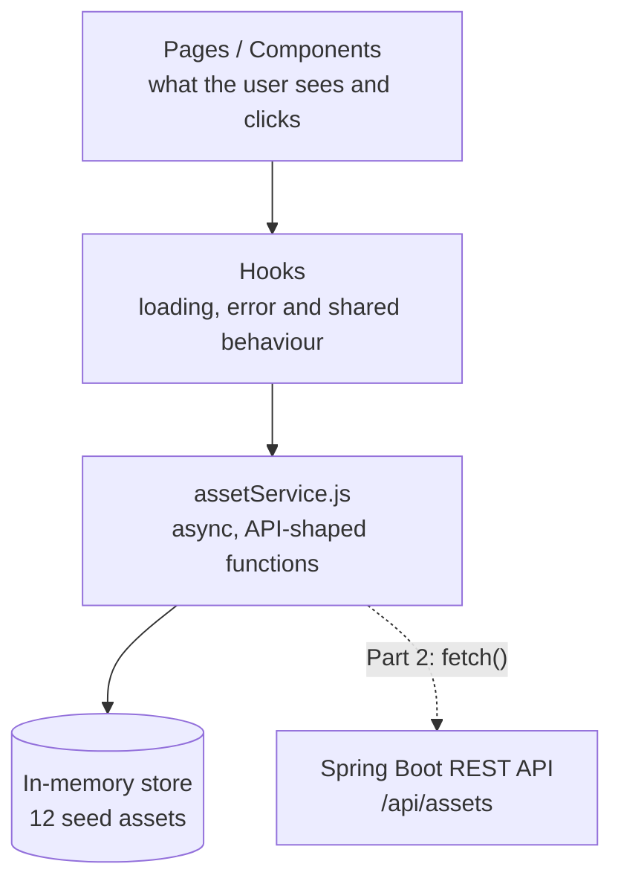
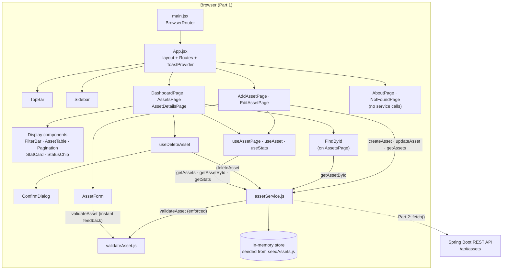
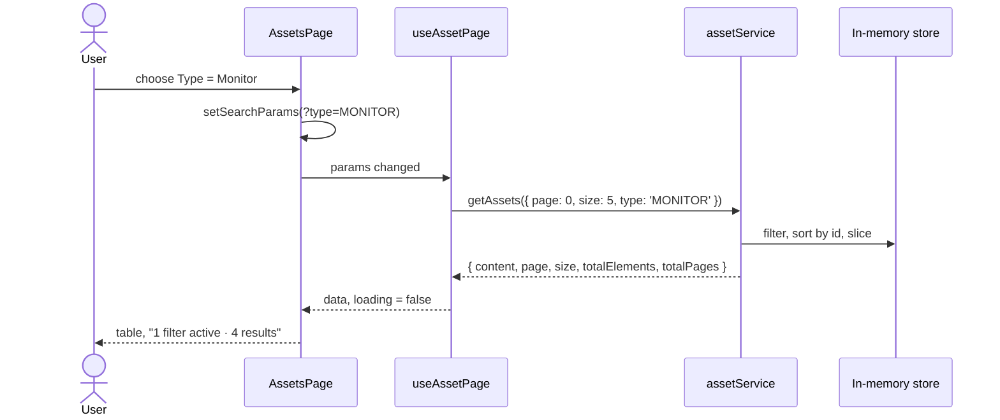
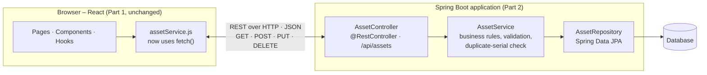

# AssetDesk – Architecture

This document describes how the Part 1 frontend is built and how it will connect to the Part 2 Spring Boot API. For what the app does, see [REQUIREMENTS.md](REQUIREMENTS.md).

## 1. Overview

AssetDesk is a single-page React app built with Vite. At the highest level it has four layers:



1. **Pages and components** render the UI and handle user input. Most data access goes through hooks. Three places call the service directly for one-off actions: `AddAssetPage` (create), `EditAssetPage` (update) and `FindById` (look up an ID on submit).
2. **Hooks** (`src/hooks`) wrap service calls with loading and error state (`useAssetPage`, `useAsset`, `useStats`). They also hold the shared delete flow (`useDeleteAsset`).
3. **`assetService`** (`src/services/assetService.js`) is the **only** module that touches asset data. In Part 1 it reads and writes an in-memory array. In Part 2 it will call the REST API with `fetch()`.
4. **The in-memory store** is a private array inside `assetService`, seeded from `src/data/seedAssets.js`.

No component imports the data array directly, so swapping the data source does not affect the UI.

### Detailed view

The detailed diagram shows exactly which files call which service functions. Labels on the arrows name the functions.



## 2. Technology stack

Versions are the ranges in `package.json`. `package-lock.json` pins the exact installed versions, which currently match these.

**Runtime dependencies (shipped to the browser)**

| Library | Version | Why we use it |
|---|---|---|
| `react` | ^18.3.1 | The UI library the course requires; components and hooks. |
| `react-dom` | ^18.3.1 | Renders React components into the browser page. |
| `react-router-dom` | ^6.30.6 | Client-side routes (`/assets/:id`, `/assets/:id/edit`, …) and filter state in the URL via `useSearchParams`. |

**Development dependencies (build, test, lint)**

| Library | Version | Why we use it |
|---|---|---|
| `vite` | ^8.3.4 | Fast dev server with instant reload, and the production bundler (`npm run build`). |
| `@vitejs/plugin-react` | ^6.1.2 | Lets Vite compile JSX and enables React Fast Refresh. |
| `vitest` | ^5.0.4 | Test runner that reuses the Vite config, with a Jest-style API (`describe`, `it`, `expect`). |
| `jsdom` | ^29.1.1 | A browser-like DOM, so components can render in tests that run in Node. |
| `@testing-library/react` | ^16.3.3 | Renders components in tests and finds elements by role and label, the way a user would. |
| `@testing-library/dom` | ^10.4.2 | The query engine underneath React Testing Library (a required peer dependency). |
| `@testing-library/user-event` | ^14.6.7 | Simulates realistic typing, clicking and key presses. |
| `@testing-library/jest-dom` | ^7.0.1 | Readable DOM assertions such as `toBeDisabled()` and `toHaveAttribute()`. |
| `eslint` | ^10.12.0 | Finds bugs and keeps the code style consistent (`npm run lint`). |
| `@eslint/js` | ^10.0.1 | ESLint's recommended JavaScript rules. |
| `eslint-plugin-react-hooks` | ^7.1.1 | Enforces the Rules of Hooks and catches effect mistakes. |
| `eslint-plugin-react-refresh` | ^0.5.7 | Warns when a file's exports would break Fast Refresh. |
| `globals` | ^17.13.0 | Tells ESLint which global names exist in the browser, Node and Vitest. |

**Not npm packages:** styling is plain CSS with custom properties (design tokens), with no UI library. The fonts, IBM Plex Sans and IBM Plex Mono, load from Google Fonts in `index.html`.

## 3. Folder structure

```
src/
  main.jsx                 # entry: BrowserRouter + global CSS
  App.jsx                  # layout (TopBar, Sidebar, drawer state) + routes + ToastProvider
  routerFuture.js          # React Router v7 opt-in flags
  styles/
    tokens.css             # colour tokens (light + dark), fonts, sizes
    global.css             # all component styles
  data/
    constants.js           # enum codes, display labels, page sizes, empty asset
    seedAssets.js          # the 12 sample assets
    team.js                # team members for the About page
  services/
    assetService.js        # the data layer (see section 6)
    ApiError.js            # error class: status, message, fieldErrors
    validateAsset.js       # validation rules shared by the form and the service
  hooks/
    useAssets.js           # useAssetPage, useAsset, useStats (loading/error state)
    useDeleteAsset.jsx     # confirm dialog + delete + toast
    useGoBack.js           # "Cancel" → previous page, with a fallback
    useMediaQuery.js       # phone vs. desktop layout
  components/              # reusable UI pieces (section 4)
  pages/                   # one component per route (section 5)
  utils/format.js          # date formatting ("14 Feb 2025")
  tests/                   # Vitest + React Testing Library
docs/
  REQUIREMENTS.md
  ARCHITECTURE.md
```

## 4. Component tree

```
<BrowserRouter>
  <App>
    <ToastProvider>                      toast state + bottom-right toast
      <TopBar />                         hamburger, logo
      <div.drawer-scrim />               phone backdrop
      <Sidebar />                        menu links, active item
      <main>
        <Routes>
          DashboardPage                  StatCard ×4, type bars, needs-attention list (StatusChip)
          AssetsPage                     FindById, FilterBar, AssetTable (StatusChip), Pagination, ConfirmDialog
          AssetDetailsPage               StatusChip, definition list, ConfirmDialog | AssetLoadError
          AddAssetPage                   AssetForm
          EditAssetPage                  AssetForm | AssetLoadError
          AboutPage                      team table, fact cards
          NotFoundPage
```

Shared pieces:

| Component | Purpose |
|---|---|
| `PageHeader` | Eyebrow text, `<h1>` and an optional action on the right |
| `AssetForm` | The Add/Edit form. It validates with `validateAsset()` and shows the service's 400/409 field errors |
| `ConfirmDialog` | Modal confirm dialog: focus trap, Escape and backdrop close, focus returns afterwards |
| `Toast` / `ToastContext` | `useToast()` returns `showToast(message)` |
| `AssetLoadError` | Friendly "No asset with ID n." page |
| `Icons` | Inline SVG icons from the mockup |

## 5. Routing

| Path | Page | Menu item highlighted |
|---|---|---|
| `/` | `DashboardPage` | Dashboard |
| `/assets` | `AssetsPage` | Assets |
| `/assets/new` | `AddAssetPage` | Add Asset |
| `/assets/:id` | `AssetDetailsPage` | Assets |
| `/assets/:id/edit` | `EditAssetPage` | Assets |
| `/about` | `AboutPage` | About |
| `*` | `NotFoundPage` | – |

The Assets page keeps its state in the query string, read and written with `useSearchParams`:

```
/assets?q=dell&type=MONITOR&condition=GOOD&status=AVAILABLE&page=2&size=10
```

`page` in the URL counts from 1 for readability; the service's `page` counts from 0. Default values are left out of the URL.

## 6. Data flow



- **Reads.**
  - Pages read data through hooks (`useAssetPage`, `useAsset`, `useStats`). Each hook calls the service, tracks `data`, `error` and `loading`, and ignores answers from out-of-date requests.
  - `FindById` is the one exception: it calls `getAssetById()` directly when the form is submitted.
- **Writes.**
  - `AddAssetPage` calls `createAsset()`, then `getAssets()` to find the last page.
  - `EditAssetPage` calls `updateAsset()`.
  - Deletes go through the `useDeleteAsset` hook (used by `AssetsPage` and `AssetDetailsPage`), which calls `deleteAsset()`.
  - After each write the app navigates or reloads, and shows a toast.
- **Errors.** The service throws `ApiError(status, message, fieldErrors)`:
  - a 404 becomes a not-found message
  - 400 and 409 `fieldErrors` appear under the matching form fields
- **Copies.** The service always returns copies, so components can never change the store by accident, just as with a real API.
- **Latency.** The service waits 150 ms (`DELAY_MS`) before answering, so loading states are visible. Under Vitest the delay is 0.

### Service contract (`src/services/assetService.js`)

| Function | Future REST route | Returns / throws |
|---|---|---|
| `getAssets({ page = 0, size = 5, q, type, condition, status })` | `GET /api/assets?page=&size=&q=&type=&condition=&status=` | `{ content, page, size, totalElements, totalPages }` (page is 0-based).<br>Every filter is optional and they combine with AND. `type`, `condition` and `status` match the enum code exactly. `q` is a case-insensitive "contains" search on deviceName, serialNumber and assignedTo only; a blank `q` means no search.<br>Totals reflect the filtered results, sorted by id ascending. |
| `getAssetById(id)` | `GET /api/assets/{id}` | The asset, or throws `ApiError(404, 'No asset with ID {id}.')` |
| `createAsset(data)` | `POST /api/assets` | The created asset with its new id.<br>Throws `ApiError(400, …, fieldErrors)` on validation failure, or `ApiError(409, …, { serialNumber })` on a duplicate serial. |
| `updateAsset(id, data)` | `PUT /api/assets/{id}` | The updated asset. Same 400 / 409 rules (the duplicate check ignores the asset itself); 404 if the id is missing. |
| `deleteAsset(id)` | `DELETE /api/assets/{id}` | Nothing; 404 if the id is missing |
| `getStats()` | computed client-side, or `GET /api/assets/stats` | `{ total, available, assigned, inRepair, byType: { LAPTOP: n, … }, needsAttention: Asset[] }` |
| `resetStore()` | – | Restores the seed data (tests only) |

## 7. Feature map

How each feature reaches the data layer, and the REST route it will use in Part 2.

| Feature | Page / component | Service function (called via) | Part 2 REST route |
|---|---|---|---|
| Dashboard counters, type bars, needs-attention list | `DashboardPage`, `StatCard`, `StatusChip` | `getStats()` via `useStats` | computed client-side, or `GET /api/assets/stats` |
| Asset list and pagination | `AssetsPage`, `AssetTable`, `Pagination` | `getAssets({ page, size })` via `useAssetPage` | `GET /api/assets?page=&size=` |
| Search and filters | `AssetsPage`, `FilterBar` | `getAssets({ q, type, condition, status })` via `useAssetPage` | `GET /api/assets?q=&type=&condition=&status=` |
| Find asset by ID | `FindById` (on `AssetsPage`) | `getAssetById(id)`, called directly | `GET /api/assets/{id}` |
| Asset details | `AssetDetailsPage` | `getAssetById(id)` via `useAsset` | `GET /api/assets/{id}` |
| Add asset | `AddAssetPage`, `AssetForm` | `validateAsset()`, then `createAsset(data)` and `getAssets()` (to find the last page), called directly | `POST /api/assets`, then `GET /api/assets` |
| Edit asset | `EditAssetPage`, `AssetForm` | `getAssetById(id)` via `useAsset` to prefill; `validateAsset()`, then `updateAsset(id, data)`, called directly | `GET /api/assets/{id}`, `PUT /api/assets/{id}` |
| Delete asset | `AssetsPage` / `AssetDetailsPage`, `ConfirmDialog` | `deleteAsset(id)` via `useDeleteAsset` | `DELETE /api/assets/{id}` |
| Menu and layout | `TopBar`, `Sidebar`, `App` | none | – |
| About the team | `AboutPage` (data from `src/data/team.js`) | none | – |
| Not found | `NotFoundPage`, `AssetLoadError` | none (shows a 404 from `getAssetById`) | – |

## 8. Styling

- `tokens.css` holds the mockup's colour tokens. A `prefers-color-scheme: dark` block switches to the dark palette, and `data-theme="light"` or `data-theme="dark"` on `<html>` can force either one.
- `global.css` ports the mockup's classes (`.card`, `.btn`, `.chip`, `.filters`, `.pager`, and so on). Components use these class names; there are no CSS modules or UI library.
- The layout breakpoints are 900 px (pinned menu or drawer) and 700 px (the filter controls stack).

## 9. Testing

- Vitest runs with jsdom. `src/tests/setup.js` loads the jest-dom matchers and a `matchMedia` stub.
- `assetService.test.js` tests the data contract directly.
- The page tests render the whole `<App>` inside a `MemoryRouter` (`renderApp.jsx`) and drive it like a user with `@testing-library/user-event`.
- Every test file calls `resetStore()` in `beforeEach`.

## Part 2 plan

In Part 2 the team will hand-write a Spring Boot REST API with the same routes and response shapes as the service contract in section 6.

### Target architecture



- **Controller.** Maps the HTTP routes to service methods. Validation and "not found" errors become JSON `{ message, fieldErrors }` with status 400, 404 or 409.
- **Service.** Holds the same rules as `validateAsset()` and the serial-number uniqueness check.
- **Repository.** Reads and writes the `Asset` entity in the database.
- The class names above are suggestions, and the team will choose the database in Part 2.

### Frontend changes

Connecting the frontend means changing **only `src/services/assetService.js`**:

1. Replace the in-memory store with `fetch()` calls to `/api/assets…`. Build the query string from the same `getAssets` parameters.
2. When a response is not OK, read its JSON body and throw `new ApiError(response.status, body.message, body.fieldErrors ?? {})`. Components already handle 400, 404 and 409 this way.
3. Remove `resetStore()` and `DELAY_MS`. The service tests switch to mocking `fetch` or to running against a test server.
4. Keep `validateAsset()` on the client for instant feedback. The Spring API repeats the same rules with Bean Validation and returns them as `fieldErrors`.

Pages, components and hooks need no changes, because they already use async functions that return API-shaped data and throw `ApiError`.
